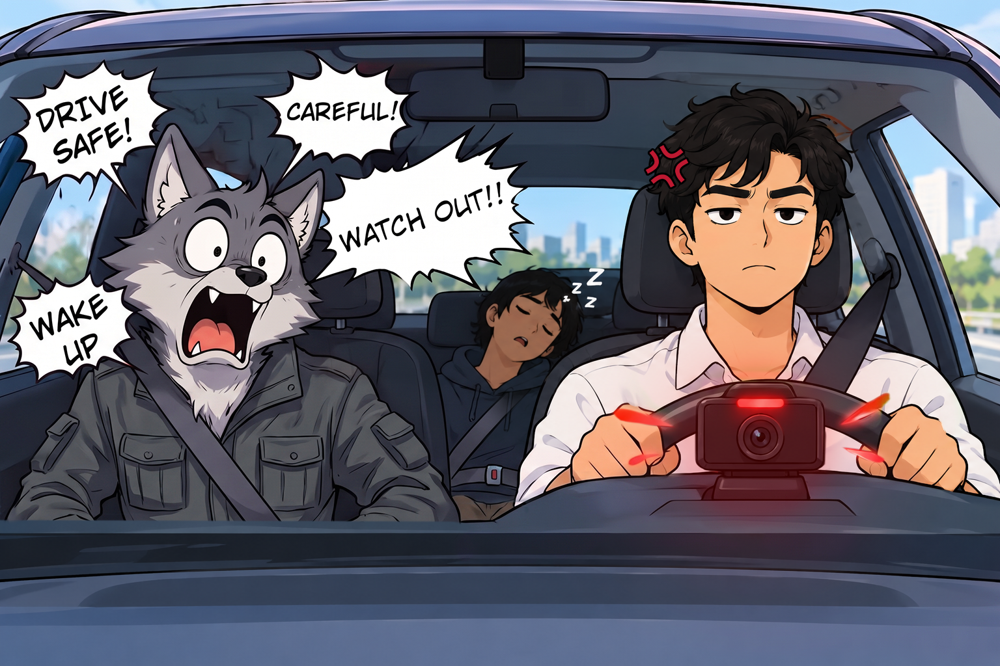

<h1 align="center">Design and Implementation of an Edge Based Driver Monitoring System with False Alarm Reduction</h1>

<p align="center" dir="rtl">
  <strong>تصميم وتنفيذ نظام مراقبة للسائق قائم على الحوسبة الطرفية مع الحد من الإنذارات الخاطئة</strong>
</p>

<p align="center">
  
  
  
  
  
  
  
</p>

<p align="center">
  
</p>

---

## Project Information

- **Institution:** University of Sharjah
- **College:** College of Computing and Informatics
- **Department:** Computer Engineering Department
- **Project Track:** Hardware / Embedded Systems & AI / Robotics
- **Academic Year:** Fall 2026-2027

---

## Team Members

| Member | Student ID | Email | Major |
| :--- | :---: | :--- | :---: |
| **Oumar Mamoun Ibrahim** | U22200741 | [U22200741@sharjah.ac.ae](mailto:U22200741@sharjah.ac.ae) | CPE |
| **Abdullah Jafar Abdelhamid** | U23101327 | [U23101327@sharjah.ac.ae](mailto:U23101327@sharjah.ac.ae) | CPE |
| **Faris Munadhil Ahmed Alagha** | U23104246 | [U23104246@sharjah.ac.ae](mailto:U23104246@sharjah.ac.ae) | CPE |
| **Mohamed Ahmed Saad Khafagy** | U20101649 | [U20101649@sharjah.ac.ae](mailto:U20101649@sharjah.ac.ae) | CPE |

## Supervisor

**Dr. Mohamad Khairi Bin Ishak**  
*Associate Professor, Department of Computer Engineering — College of Computing and Informatics, University of Sharjah*

[](mailto:mishak@sharjah.ac.ae)
[](https://orcid.org/0000-0002-3554-0061)
[](https://scholar.google.com/citations?user=yePUu3cAAAAJ&hl=en)
[](https://www.researchgate.net/profile/Mohamad-Khairi-Ishak-2?ev=prf_overview)

---

## Academic Proposal & Documentation

The complete academic proposal report has been compiled and validated:

- **Proposal PDF:** [docs/PDFs/Proposal.pdf](docs/PDFs/Proposal.pdf) (19 pages, IEEE format, TikZ statistical distributions, system architecture block diagrams, feature priority matrices, and research roadmap).
- **LaTeX Source Code:** [docs/report/Proposal/](docs/report/Proposal/)
  - `Proposal.tex`: Main LaTeX document preamble, committee attribution, and structure.
  - `Chapters/Chapter_1.tex`: Problem statement, accident statistics (involvement and severity for drowsiness and distraction), limitations of traditional DMS, proposed solution, differentiator analysis, feature requirements, and semester timeline.
  - `acronyms/acronyms.tex`: Terminology glossary definitions (DMS, IR, RGB, YOLO, GSR, EAR, PERCLOS, EMA, WAL, ROI, RTA).
  - `Bibliography/references.bib`: Complete academic bibliography and references.
  - `Figures/`: System block diagrams, empirical evaluation charts, and institution branding.

---

## Problem Statement and Proposed Solution

Driver Monitoring Systems (DMS) evolved since their introduction in 2006, transitioning from simple alerts through infrared cameras to eye gaze tracking and vehicular spatial fusion. However, nuisance alerts and false alarms cause driver distrust in these systems, resulting in system neglect or active circumvention. The research gap centers on improving user experience, contextual calibration, and reliability in real-world driving environments.

In 2024, the European Union's General Safety Regulation (GSR) mandated that all newly registered vehicles must include a DMS. To support this surging rate of deployment, systems must deliver trustworthy performance without distracting the driver with unnecessary warnings.

We counter traditional DMS shortcomings through:
1. **Dynamic ROI Face Cropping:** Continuous face-center tracking providing smooth 640x640 crops for focused visual inference.
2. **Hard Negative Mining & Nano-Scale Detection:** Deploying YOLO11n to eliminate false positive object cues (e.g. hand on chin vs. phone, talking vs. yawning).
3. **Continuous Exponential Moving Average (EMA) Filtering:** True time-delta continuous filtering to reject momentary frame classification noise.
4. **Mirror-Check Glance Suppression:** Mirror checks lasting under 1.5 seconds are suppressed from triggering false distraction alarms.
5. **Multi-Tier Escalation:** Graduated response from Tier 1 gentle chimes to Tier 2 bilingual voice warnings (English and Arabic) and Tier 3 high-urgency alarms.
6. **20-Second Driver Baseline Calibration:** Pre-drive eye aspect ratio (EAR) baseline capture computing 99th percentile personalized cutoffs.
7. **Pre-Trip Driver Readiness Survey:** Standardized psychometric fatigue self-assessment before highway journeys.
8. **Context-Aware Highway Rest Stop Routing:** Proactive POI recommendations for UAE highway corridors (E11, E311, E611).
9. **Power-Cut Safe SQLite WAL Logging:** Write-Ahead Logging ensuring zero data loss during vehicle ignition cuts.

---

## Models Considered & Benchmark Results

The following benchmark comparisons reflect evaluation on subject-disjoint driver monitoring datasets:

### Visible Spectrum (RGB)
*Primary candidate:* **[YOLO11n](https://docs.ultralytics.com/models/yolo11/)**

| Model | Overall Normalized Score |
| :--- | :---: |
| **YOLO11n** | **70.93** |
| YOLO26n | 53.60 |
| D-FINE-N | 29.68 |

### Near-Infrared Spectrum (NIR)
*Primary candidate:* **[YOLOv8n](https://docs.ultralytics.com/models/yolov8/)**

| Model | Overall Normalized Score |
| :--- | :---: |
| **YOLOv8n** | **89.50** |
| RT-DETRv2-S | 75.65 |
| D-FINE-N | 70.72 |
| YOLO11n | 51.12 |
| YOLO26n | 46.43 |

---

## System Architecture

```text
+---------------------------------------------------------------------------------+
|                                 SENSING LAYER                                   |
|   1080p 30 FPS Camera Ingestion  |  Optical Camera Occlusion / Sharpness Check  |
+---------------------------------------------------------------------------------+
                                         |
                                         v
+---------------------------------------------------------------------------------+
|                              EDGE VISION PIPELINE                               |
|   Dynamic 640x640 ROI Crop       |  YOLO11n Nano In-Cabin Object Detection      |
|   Facial Landmark Tracking       |  Eye Aspect Ratio (EAR) & 60s PERCLOS Engine |
+---------------------------------------------------------------------------------+
                                         |
                                         v
+---------------------------------------------------------------------------------+
|                       TEMPORAL & CONTEXTUAL FILTERING                           |
|   Continuous EMA Smoothing (dt)  |  Mirror-Check Suppression (<1.5s glances)    |
|   Alert Cooldown (10s lock)      |  Hysteresis State Machine                    |
+---------------------------------------------------------------------------------+
                                         |
                                         v
+---------------------------------------------------------------------------------+
|                          ACTUATION & PERSISTENCE                                |
|   Multi-Tier Alerts (Chime / Bilingual Voice / Siren) | LED Status Bar (RGB)   |
|   Power-Cut Safe SQLite WAL Telemetry Logging          | HTTP / MJPEG Stream    |
+---------------------------------------------------------------------------------+
                                         |
                                         v
+---------------------------------------------------------------------------------+
|                      IN-CABIN TABLET & DESKTOP DASHBOARD                        |
|   Live Monitor View (HUD Canvas, LED Strip, Calibration, Survey, Rest Stops)     |
|   Trips Log & Timeline Playback  |  Longitudinal Statistics & Attention Heatmap |
+---------------------------------------------------------------------------------+
```

---

## Repository Structure

Every directory contains a dedicated `README.md` documenting its files and operational purpose:

```text
Senior Design Project/
├── LICENSE                 # Apache License 2.0
├── README.md               # Master system documentation, architecture, and guides
├── comic.png               # Conceptual illustration of driver monitoring
├── build_diagram.py        # System block diagram generator script
├── driver-monitoring-block-diagram.png # Architecture block diagram
├── Volunteer_Video_Consent_Form.pdf    # Ethics & video collection consent form
├── package.json            # Node.js dependencies, scripts, and Electron configuration
├── vite.config.ts          # Vite build configuration with React plugin
├── tsconfig.json           # TypeScript configuration
├── dms/                    # Real-time Python Edge Driver Monitoring System
│   ├── README.md           # Edge pipeline documentation
│   ├── camera.py           # 1080p 30 FPS camera capture & synthetic driver simulator
│   ├── blindness.py        # Camera blindness, occlusion, and sharpness detector
│   ├── roi.py              # Dynamic face center tracking & 640x640 crop
│   ├── detector.py         # YOLO11n object detector with heuristic fallback
│   ├── eye_tracker.py      # Left/right EAR, blink counter, and rolling 60s PERCLOS
│   ├── temporal_filter.py  # Continuous-time Exponential Moving Average (EMA) filter
│   ├── suppression.py      # Mirror glance suppression, hysteresis, and alert cooldowns
│   ├── alerts.py           # Multi-tier alert dispatcher (audio WAV, English/Arabic voice, LED)
│   ├── calibration.py      # 20-second baseline calibration calculating 99th percentile cutoffs
│   ├── readiness.py        # Pre-trip driver fatigue and readiness psychometric survey
│   ├── rest_stops.py       # UAE highway rest stop lookup service (E11, E311, E611)
│   ├── database.py         # Power-cut safe SQLite WAL telemetry logger
│   ├── engine.py           # Core orchestrator pipeline with HUD visualizer
│   ├── server.py           # Multi-threaded HTTP and MJPEG streaming server (port 8765)
│   ├── cli.py              # Command-line interface subcommands
│   └── __main__.py         # Entry point for python -m dms
├── src/                    # In-Cabin Tablet & Desktop Dashboard (React 18 + TypeScript)
│   ├── README.md           # Frontend architecture documentation
│   ├── App.tsx             # Main application layout, view switching, and navigation state
│   ├── components/         # UI component hierarchy
│   │   ├── README.md       # Component hierarchy documentation
│   │   ├── common/         # Layout headers, title bars, and navigation sidebar
│   │   ├── dashboard/      # Fleet KPIs, trend charts, breakdowns, and heatmaps
│   │   ├── live/           # In-cabin live tablet monitor with HUD canvas and controls
│   │   ├── settings/       # Threshold sliders, language options, and audio controls
│   │   ├── statistics/     # Longitudinal driving analytics and vigilance trends
│   │   └── trips/          # Trip logs, session filtering, and detail modal
│   ├── services/           # Service layer and IPC abstraction
│   │   ├── README.md       # Service layer overview
│   │   ├── api.ts          # Unified Electron IPC and browser fallback bridge
│   │   └── db/             # SQLite schema, queries, seeder, and WASM sql.js wrapper
│   └── types/              # TypeScript interfaces for trips, alerts, and telemetry
├── electron/               # Electron main desktop runtime
│   ├── README.md           # Desktop integration documentation
│   ├── main.ts             # Frameless browser window, lifecycle, and IPC handlers
│   ├── preload.ts          # Secure context bridge exposing window.driveSafeAPI
│   └── database/           # Native better-sqlite3 database handlers
├── docs/                   # Documentation, specifications, and academic reports
│   ├── README.md           # Documentation guide
│   ├── VigilBench_Spec.md  # Detailed benchmark specification
│   ├── guide/              # University senior design project guidelines and tutorial
│   ├── templates/          # Official academic report templates
│   ├── references/         # Literature papers and research benchmarks
│   ├── PDFs/               # Compiled publication PDFs (Proposal.pdf)
│   └── report/             # LaTeX report sources
│       └── Proposal/       # Complete Proposal LaTeX document (Chapter 1, TikZ, BibTeX)
├── Capstone/               # Submodule containing course assets, audio tones, and guides
│   ├── Alarm/              # Synthesized WAV alerts and MATLAB generation scripts
│   ├── Build/              # Hardware bill of materials and dashboard UI mockups
│   ├── Dataset/            # Video collection guidelines and protocols
│   └── Report/             # Colorblind-safe palettes and report assets
└── tests/                  # Automated verification suites
    ├── README.md           # Test suite documentation
    ├── test_dms_engine.py  # Python unittest verifying all DMS logic modules
    └── verify-db.js        # Node.js SQLite WAL schema and query verification
```

---

## Installation & Running the Software

### Prerequisites

- **Python 3.10+** (with `torch`, `ultralytics`, `opencv-python`, `numpy`, `scipy`)
- **Node.js 18+** and **npm**

### 1. Edge Driver Monitoring Engine (Python)

```bash
# Run unit tests verifying all edge engine components
python -m unittest tests/test_dms_engine.py

# Run a headless dry-run on 100 simulated frames
python -m dms dry-run --frames 100

# Run 20-second pre-drive baseline calibration
python -m dms calibrate

# Take the pre-trip driver readiness survey
python -m dms readiness

# Check nearest UAE highway rest stops
python -m dms rest-stops

# Launch live streaming engine with MJPEG server on port 8765
python -m dms live
```

### 2. In-Cabin Tablet & Desktop Dashboard (React + Electron)

```bash
# Install frontend dependencies
npm install

# Run database verification tests
npm test

# Build production frontend and Electron binaries
npm run build
npm run build:electron

# Launch Electron desktop application
npm run electron

# Or launch development web dashboard with hot reloading
npm run dev
```

### 3. Compiling the Academic Proposal (LaTeX)

```bash
# Navigate to Proposal LaTeX directory
cd "docs/report/Proposal"

# Compile complete proposal with TikZ diagrams, BibTeX citations, and acronyms
pdflatex Proposal.tex
bibtex Proposal
makeglossaries Proposal
pdflatex Proposal.tex
pdflatex Proposal.tex
```

---

## Verification & Testing Gates

All software components undergo rigorous automated validation:

- **Edge DMS Unit Tests (`tests/test_dms_engine.py`):** 11 test cases validating blindness detection, eye tracking, EAR, PERCLOS, continuous EMA filtering, mirror-glance suppression (<1.5s), alert cooldowns (10s), readiness surveys, rest stop locator, and SQLite WAL database insertion and truncate checkpoints.
- **Dry-Run Benchmark:** Verified sustained 14+ FPS processing throughput with dynamic ROI crop and telemetry persistence.
- **Database Schema Tests (`tests/verify-db.js`):** Validated table creation, foreign keys, telemetry sampling, and aggregate KPI calculation.
- **TypeScript & Build Gates:** Clean compilation across Vite frontend (`npm run build`) and Electron main process (`npm run build:electron`).
- **LaTeX Compilation Gate:** Clean PDF compilation generating the 19-page proposal report without fatal errors.

---

## License

This project is licensed under the Apache License 2.0 - see the [LICENSE](LICENSE) file for details.

---

## References

- <a id="ref-1"></a>**[1]** F. Lyrheden, *"How Driver Monitoring Systems (DMS) Are Being Made Mandatory in 18 Million European Cars,"* Smart Eye, Apr. 28, 2023. [Online]. Available: [smarteye.se](https://smarteye.se/blog/the-general-safety-regulations-gsr-and-driver-monitoring-systems-dms/). [Accessed: Sep. 6, 2026].
- <a id="ref-2"></a>**[2]** G. Merlhiot and M. Bueno, *"How drowsiness and distraction can interfere with take-over performance: A systematic and meta-analysis review,"* Accident Analysis & Prevention, vol. 170, Art. no. 106536, Jun. 2022. doi: [10.1016/j.aap.2021.106536](https://doi.org/10.1016/j.aap.2021.106536).
- <a id="ref-3"></a>**[3]** F. Lambert, *"Chinese drivers are using plastic heads to fool Tesla’s Autopilot cabin camera,"* Electrek, Jun. 15, 2026. [Online]. Available: [electrek.co](https://electrek.co/2026/06/15/chinese-drivers-plastic-heads-fool-tesla-autopilot-camera/). [Accessed: Sep. 6, 2026].
- <a id="ref-4"></a>**[4]** O. M. Ibrahim, M. K. bin Ishak, K. Ammar, and N. M. Mirza, *"Lightweight Object Detection for Driver Monitoring: A Subject-Disjoint Benchmark,"* [Available in Repository](docs/references/to_start_with/manuscript.pdf).
