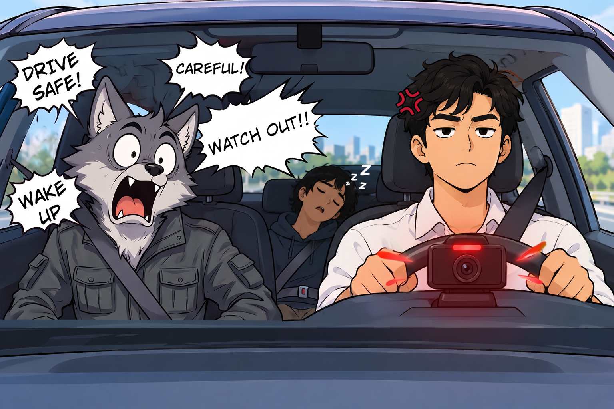

<h1 align="center">Design and Implementation of an Edge Based Driver Monitoring System with False Alarm Reduction</h1>

<p align="center" dir="rtl">
  <strong>تصميم وتنفيذ نظام مراقبة للسائق قائم على الحوسبة الطرفية مع الحد من الإنذارات الخاطئة</strong>
</p>

<p align="center">
  
  
  
  
  
  
  
</p>

<p align="center">
  
</p>

---

## Team & Supervisor

| Member | Student ID | Email | Major |
| :--- | :---: | :--- | :---: |
| **Oumar Mamoun Ibrahim** | U22200741 | [U22200741@sharjah.ac.ae](mailto:U22200741@sharjah.ac.ae) | CPE |
| **Abdullah Jafar Abdelhamid** | U23101327 | [U23101327@sharjah.ac.ae](mailto:U23101327@sharjah.ac.ae) | CPE |
| **Faris Munadhil Ahmed Alagha** | U23104246 | [U23104246@sharjah.ac.ae](mailto:U23104246@sharjah.ac.ae) | CPE |
| **Mohamed Ahmed Saad Khafagy** | U20101649 | [U20101649@sharjah.ac.ae](mailto:U20101649@sharjah.ac.ae) | CPE |

**Supervisor: Dr. Mohamad Khairi Bin Ishak** — Associate Professor, Department of Computer Engineering, University of Sharjah  
[](mailto:mishak@sharjah.ac.ae) [](https://orcid.org/0000-0002-3554-0061) [](https://scholar.google.com/citations?user=yePUu3cAAAAJ&hl=en)

---

## Problem Statement

Driver Monitoring Systems (DMS) have evolved since 2006, but nuisance alerts and false alarms cause driver distrust, leading to system neglect or active circumvention. The EU General Safety Regulation (2024) mandates DMS in all newly registered vehicles, demanding trustworthy, low-false-alarm performance. This project addresses that gap through contextual filtering, personalized baselines, and edge-optimised nano-scale detection on a Raspberry Pi 4 platform.

---

## Model Benchmark Results

Evaluated on subject-disjoint driver monitoring datasets (Overall Normalized Score, higher is better).

### Visible Spectrum (RGB) — Primary: YOLO11n

| Model | Overall Normalized Score |
| :--- | :---: |
| **YOLO11n** | **70.93** |
| YOLO26n | 53.60 |
| D-FINE-N | 29.68 |

### Near-Infrared Spectrum (NIR) — Primary: YOLOv8n

| Model | Overall Normalized Score |
| :--- | :---: |
| **YOLOv8n** | **89.50** |
| RT-DETRv2-S | 75.65 |
| D-FINE-N | 70.72 |
| YOLO11n | 51.12 |
| YOLO26n | 46.43 |

---

## Quickstart

**Prerequisites:** Python 3.10+, Node.js 18+

```bash
# Edge DMS engine
python -m dms dry-run --frames 100   # headless smoke-test
python -m dms calibrate              # 20-second EAR baseline
python -m dms live                   # launch MJPEG stream on :8765

# Dashboard (React + Electron)
npm install && npm run build && npm run electron
```

Academic proposal PDF: [docs/PDFs/Proposal.pdf](docs/PDFs/Proposal.pdf)

---

## License

This project is licensed under the Apache License 2.0 — see the [LICENSE](LICENSE) file for details.
